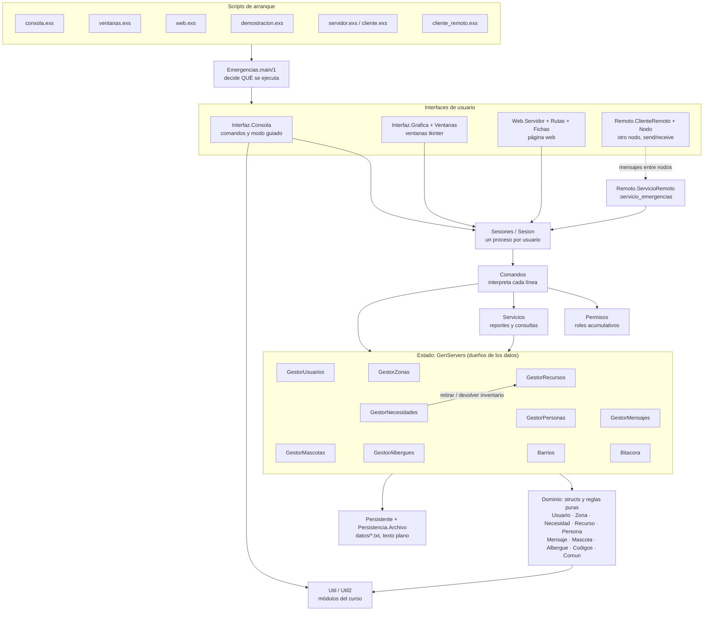
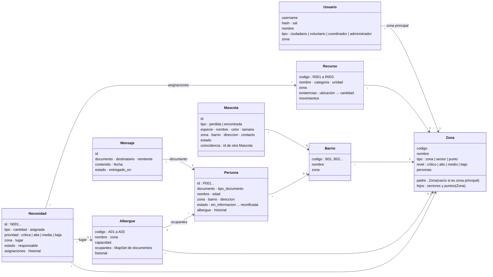
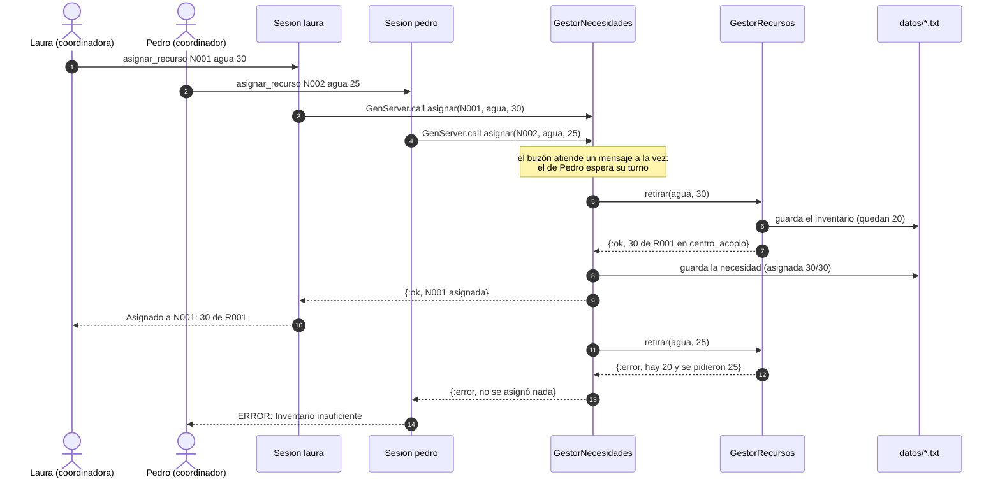
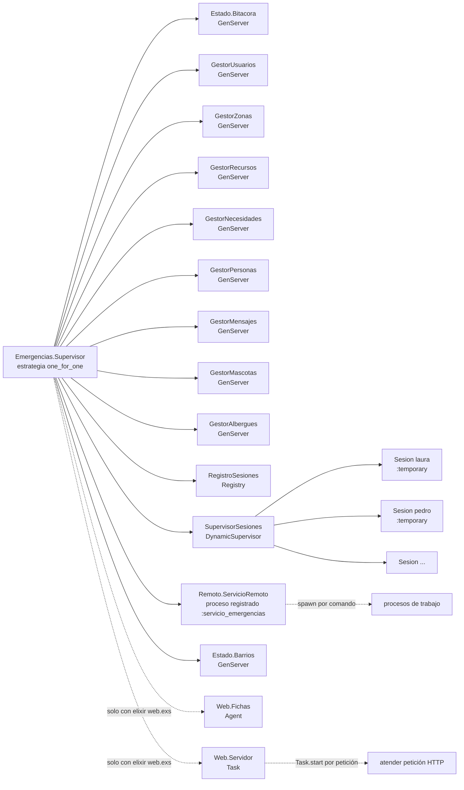

# Sistema Distribuido de Coordinación y Gestión de Emergencias

Proyecto final de **Programación III** (Universidad del Quindío). Es un sistema
multiusuario y concurrente en Elixir/OTP para coordinar la atención después de
un terremoto. Maneja usuarios con roles, zonas con sectores y puntos de
atención, necesidades, recursos, albergues, comunicación entre familiares y
mascotas perdidas o encontradas.

No usa dependencias externas, solo Elixir ≥ 1.18 (probado con Elixir 1.19.5 y OTP 28).

## Cómo ejecutarlo

Los scripts se ejecutan con `elixir archivo.exs`, como en clase, desde la
carpeta del proyecto. Cada script empieza cargando `cargar.exs`, que compila el
proyecto si hace falta (`mix compile`) y arranca el sistema.

| Para… | Comando |
|---|---|
| Consola interactiva (un usuario por consola) | `elixir consola.exs` |
| **Ventanas emergentes** (interfaz gráfica, necesita Python 3 con tkinter) | `elixir ventanas.exs` |
| **Página web** (opcional, http://localhost:4000) | `elixir web.exs` |
| Ejecutar los comandos de un archivo | `elixir consola.exs ejemplos/flujo.txt` |
| **Demostración automática** con varios usuarios en paralelo y el conflicto concurrente | `elixir demostracion.exs` |
| **Modo distribuido**: servidor (terminal 1) | `elixir servidor.exs` |
| **Modo distribuido**: cliente con la consola completa (terminal 2, 3, …) | `elixir cliente.exs` |
| **Modo distribuido**: cliente con menú y send/receive (terminal 2, 3, …) | `elixir cliente_remoto.exs` |
| Generar la cookie compartida (`my_cookie`) | `elixir cookie.exs` |
| Pruebas automáticas (62 pruebas y 22 doctests) | `mix test` |
| Consola de Elixir | `iex -S mix` |

Con `mix run archivo.exs` también funcionan (por ejemplo `mix run consola.exs`).

Los comandos están en español. Los nombres en inglés del enunciado (`connect`,
`register_need`, `summary`…) también funcionan como alias.

## Modo distribuido (varios nodos)

Cada terminal es otro **nodo** de Erlang (una instancia de la BEAM), y todos
trabajan sobre los mismos datos del servidor. Así se ven varios usuarios
conectados a la vez (`sesiones`). Cada script inicia su nodo con `Node.start/2`
y pone la cookie con `Node.set_cookie/1`, como en la guía "Aplicaciones distribuidas".

**En la misma máquina** (nombres cortos, `servidor@EQUIPO`):

```bash
elixir servidor.exs            # terminal 1
elixir cliente_remoto.exs      # terminal 2, 3, ...
```

**En máquinas diferentes de la misma red** (nombres completos con IP). Use
`ipconfig` para ver la "Dirección IPv4" de cada equipo:

```bash
elixir cookie.exs                                  # una vez; copie my_cookie a todas las máquinas
elixir servidor.exs 192.168.1.20                   # en el servidor -> :"servidor@192.168.1.20"
elixir cliente_remoto.exs 192.168.1.20             # en cada cliente (detecta su propia IP)
elixir cliente_remoto.exs 192.168.1.20 192.168.1.21   # o indicándola
```

Hay dos clientes, y el servidor atiende a los dos al mismo tiempo:

| Cliente | Cómo habla con el servidor |
|---|---|
| `cliente.exs` | Consola completa. Llama a las sesiones del servidor con `:erpc`. |
| `cliente_remoto.exs` | Menú como el del cajero. Envía mensajes con `send({:servicio_emergencias, nodo}, {..., self(), ...})` y espera la respuesta con `receive ... after`. |

`Emergencias.Remoto.ServicioRemoto` es el proceso registrado
`:servicio_emergencias` del servidor. Su `loop` recursivo atiende
`{:conectar, pid, usuario, contraseña}`, `{:comando, pid, linea}`,
`{:estado_zonas, pid}` y `{:fin, pid}` (responde `:adios`). Cada comando se
ejecuta con `spawn` en otro proceso, así un cliente lento no bloquea a los
demás. El estado de todas las zonas se consulta en paralelo con
`Task.async_stream`. Los permisos del rol se siguen validando en la sesión del usuario.

### Problemas comunes

| Síntoma | Causa | Solución |
|---|---|---|
| `register/listen error: econnrefused` | EPMD no está activo | El script intenta iniciarlo solo. Si no puede: `epmd -daemon` (en Windows está en `C:\Program Files\Erlang OTP\erts-*\bin`) |
| `the name ... seems to be in use` | Ya hay un servidor abierto con ese nombre | Cierre el otro servidor. Los clientes usan un nombre al azar, así que pueden ser varios |
| No se pudo conectar entre máquinas | Cookies distintas, un nodo con nombre corto y otro con IP, o el firewall | Copie el mismo `my_cookie`, pase la IP a todos los scripts y abra los puertos 4369 (EPMD) y 9000-9100 (nodos) |
| `El servidor no respondió a tiempo` | El servidor se cerró o no tiene el proceso `:servicio_emergencias` | Verifique en el servidor con `Process.whereis(:servicio_emergencias)` |

Los datos se guardan en `datos/`, en archivos de texto plano. La demo usa
`datos_demo/` y las pruebas usan `tmp/datos_test/`, así ninguna borra los datos reales.

### Ejemplo de sesión

```text
emergencias> conectar laura 1234 coordinador centro
Usuario nuevo registrado y conectado: laura (@laura), rol coordinador, zona centro.
laura@coordinador> registrar_zona centro "Zona Centro" critico 1200
laura@coordinador> registrar_necesidad agua 30 critica centro "Punto de atención sector 3"
laura@coordinador> registrar_recurso R001 agua 50 litros centro_acopio
laura@coordinador> asignar_recurso N001 agua 30
Asignado a N001: 30 de R001 en centro_acopio. Estado: asignada (30/30)
laura@coordinador> resumen
```

`ayuda` muestra los comandos que permite el rol del usuario. Los textos con
espacios van entre comillas, y los filtros se escriben como `clave=valor`
(por ejemplo `listar_necesidades zona=centro prioridad=critica`).

## Comandos

| Área | Comandos (rol mínimo entre paréntesis) |
|---|---|
| Sesión | `conectar`, `desconectar`, `ayuda`, `quien_soy`, `actividad` (ciudadano), `sesiones` (coordinador), `listar_usuarios` (administrador) |
| Zonas | `registrar_zona … [padre=]`, `actualizar_zona` (coordinador); `listar_zonas`, `estado_zona` (ciudadano) |
| Necesidades | `registrar_necesidad`, `listar_necesidades`, `necesidades_pendientes` (ciudadano); `iniciar_atencion`, `cerrar_necesidad` (voluntario); `asignar_recurso`, `atender_siguiente`, `cancelar_necesidad` (coordinador) |
| Recursos | `listar_recursos` (ciudadano); `historial_recurso` (voluntario); `registrar_recurso`, `entrada_recurso`, `salida_recurso`, `transferir_recurso`, `recursos_criticos` (coordinador) |
| Familiares | `reportar_persona`, `buscar_persona`, `historial_persona`, `enviar_mensaje`, `listar_mensajes` (ciudadano); `actualizar_persona`, `marcar_mensaje` (voluntario) |
| Mascotas | `reportar_mascota`, `listar_mascotas` (ciudadano); `buscar_coincidencias` (voluntario); `confirmar_coincidencia` (coordinador) |
| Albergues | `consultar_albergue`, `listar_albergues` (ciudadano); `registrar_ingreso`, `registrar_salida`, `reporte_albergues` (voluntario); `registrar_albergue` (coordinador) |
| Reportes | `resumen` (coordinador); `simular_falla gestor` (administrador, simula una falla) |
| Códigos | `codigos`, `codigos <tabla>`, `codigos todas` (ciudadano): tablas para escribir los registros con códigos; `registrar_barrio "nombre" zona` (ciudadano): barrio nuevo con el siguiente código B01, B02... |

Los roles son acumulativos: ciudadano < voluntario < coordinador < administrador.

### Base de datos de códigos

Para que el registro sea más fácil de escribir y estudiar, cada lista cerrada
tiene una tabla de códigos en `lib/emergencias/dominio/Codigos.ex`: tipo de
reporte (`MT1`), especie (`ES01`), color (`CO01`), tamaño (`TA2`), estado de la
persona (`PE3`), tipo de documento (`CC`), tipo de necesidad (`NT01`), prioridad
(`PR1`), nivel de zona (`NV1`) y rol (`RO2`).
Se puede escribir el **código o el valor**; se guarda el valor.

- **Especie:** solo `ES01` perro, `ES02` gato, `ES03` otro. Con `ES03` se escribe
  cuál en `especie_otra=`.
- **Color:** solo `CO01` negro, `CO02` blanco, `CO03` café, `CO04` gris, `CO05`
  otro. Con `CO05` se escribe cuál en `color_otro=`.
- **Barrio:** no hay barrios fijos. Cada barrio se registra a mano con su nombre y
  su zona y recibe el siguiente código: el primero `B01`, el segundo `B02` y así
  consecutivamente (`lib/emergencias/estado/Barrios.ex`, se guardan en
  `datos/barrios.txt`). También se registra solo si al reportar se escribe el
  nombre de un barrio nuevo junto con la zona.

```
codigos                      # índice de tablas
codigos barrio               # barrios registrados
registrar_barrio "La Castellana" norte     # → B01
registrar_barrio Granada centro            # → B02
reportar_mascota MT1 ES01 Luna CO01 TA2 B01 3001112233 caracteristicas="collar rojo"
reportar_mascota MT2 ES03 desconocido CO05 TA1 norte 3001 especie_otra=conejo color_otro=atigrado
reportar_persona 1094 "Andrés López" B02 PE3 edad=34 tipo_doc=CC direccion="Calle 10 # 5-20"
listar_mascotas especie=ES01 barrio=B01
```

`elixir codigos.exs` muestra todas las tablas y genera `CODIGOS.md` (para leer)
y `datos/codigos.csv` (para Excel, separador `;`).

## Estructura del proyecto

Cada archivo se llama igual que su módulo (`Necesidad.ex` → `Emergencias.Dominio.Necesidad`).

```text
lib/
  util/Util.ex  util/Util2.ex     Módulos del curso (profesor), sin cambios
  Emergencias.ex                  main/1: decide QUÉ se ejecuta (consola, ventanas, web, demostración, ...)
  emergencias/
    Aplicacion.ex                 Árbol de supervisión (OTP)
    dominio/                      Structs: crear, ingresar, to_string (String.Chars) y reglas puras
      Comun.ex  Usuario.ex  Zona.ex  Necesidad.ex  Recurso.ex  Codigos.ex
      Persona.ex  Mensaje.ex  Mascota.ex  Albergue.ex
    estado/                       GenServers: dueños del estado, persisten cada cambio
      GestorUsuarios.ex  GestorZonas.ex  GestorRecursos.ex  GestorNecesidades.ex
      GestorPersonas.ex  GestorMensajes.ex  GestorMascotas.ex  GestorAlbergues.ex
      Bitacora.ex  Persistente.ex  Barrios.ex
    sesiones/Sesion.ex  Sesiones.ex   Un proceso por usuario conectado
    Comandos.ex  Permisos.ex  Servicios.ex
    Demostracion.ex  Distribuido.ex   main de la demostración y del modo servidor/cliente
    Web.ex  web/Servidor.ex  web/Rutas.ex  web/Fichas.ex   Página web sin dependencias
    persistencia/Archivo.ex       Archivos de texto plano
    interfaz/Consola.ex  Grafica.ex  Ventanas.ex  Analizador.ex  Formato.ex
    remoto/Nodo.ex  ServicioRemoto.ex  ClienteRemoto.ex   Aplicaciones distribuidas (nodos, send/receive)
priv/ventanas/dialogo.py          Ventanas emergentes (tkinter), como mostrar_dialogo.py de clase
priv/web/index.html               Página web
config/config.exs                 Carpeta de datos (y la de pruebas)
cargar.exs                        Permite ejecutar los scripts con `elixir archivo.exs`
consola.exs  ventanas.exs  web.exs  demostracion.exs  servidor.exs  cliente.exs
cliente_remoto.exs  cookie.exs  codigos.exs  ejemplos/flujo.txt
test/dominio_test.exs  sistema_test.exs  remoto_test.exs  codigos_test.exs   Pruebas ExUnit
```

### Convenciones vistas en clase

- **Structs** (`dominio/`): cada uno tiene `crear/…` (valida y retorna
  `{:ok, struct}` o `{:error, motivo}`), `ingresar` (lee cada campo con
  `Util2.ingresar/2`) y `to_string` con `defimpl String.Chars`, así se puede
  escribir `"#{necesidad}"`.
- **`main` separa el QUÉ del CÓMO**: `Emergencias.main/1` elige el modo, y
  `Demostracion.main/0` lista los pasos de la demostración como llamadas a funciones
  privadas que hacen cada paso.
- **Modo guiado**: en la consola, un comando de registro sin datos (por
  ejemplo `registrar_necesidad`) pide cada campo con `ingresar` de su entidad.

## Pensamiento computacional

| Paso | Cómo se aplicó |
|---|---|
| **Abstracción** | Cada elemento de la emergencia es un struct con solo los datos necesarios (`Necesidad`, `Recurso`, `Albergue`…). La zona es un árbol: zona → sector → punto. |
| **Descomposición** | Cada solicitud pasa por las mismas capas, una responsabilidad por módulo: consola (`Consola`) → sesión (`Sesion`) → permisos y validación (`Comandos`, `Permisos`) → estado (`Gestor*`) → archivo (`Archivo`). |
| **Reconocimiento de patrones** | Lo que se repite se escribe una sola vez: `Util` y `Util2` (leer, mostrar, ordenar, filtrar, convertir colecciones), `Comun` (validar enteros, códigos y listas cerradas; normalizar; generar ids), `Codigos` (una sola función `traducir/2` para todas las tablas de códigos), `Persistente` (cargar y guardar cualquier gestor) y `Formato` (listas y resúmenes). Todos los gestores siguen el mismo patrón: `init` carga, `handle_call` valida, cambia y guarda. |
| **Algoritmos** | Recursión sobre el árbol de zonas, plan de retiro de recursos todo o nada, atención por prioridad y puntaje de similitud de mascotas (ver "Funciones recursivas propias"). |

## Diagrama de arquitectura de módulos



## Modelo de datos



## Diagrama de secuencia: dos asignaciones simultáneas sobre el mismo recurso



## Diagrama de procesos y supervisión (árbol OTP)



- **one_for_one**: si un gestor falla, se reinicia solo ese y vuelve a leer su
  archivo, así no se pierden datos (se demuestra con `simular_falla recursos`).
- Las sesiones son `:temporary`: si una falla no se reinicia sola y no afecta
  a los demás usuarios.

## Decisiones de diseño

### Concurrencia y conflictos

- Cada usuario conectado es **un proceso** (`Sesion`) y ejecuta sus comandos en
  paralelo con los demás.
- Cada parte del estado tiene **un único dueño**: un GenServer que procesa los
  mensajes de a uno. "Revisar si alcanza" y "descontar" ocurren en el mismo
  mensaje, así que no hay carreras:
  - **Recursos**: `GestorRecursos.retirar/5` es todo o nada. Con 50 litros y pedidos simultáneos de 30 y 25, se confirma uno y se rechaza el otro.
  - **Necesidades**: una necesidad no recibe dos asignaciones a la vez ni consume recursos después de atendida.
  - **Albergues**: los ingresos simultáneos nunca superan la capacidad.
  - **Mascotas**: dos confirmaciones simultáneas de la misma pareja, solo una gana.
- Lo prueban `mix test` (por ejemplo, 50 asignaciones simultáneas sobre 100
  raciones) y `elixir demostracion.exs` (30 usuarios a la vez).

### Estructuras de datos

| Estructura | Dónde | Por qué |
|---|---|---|
| Struct | Todas las entidades | Campos fijos y pattern matching sobre su tipo |
| Map | Estado de cada gestor (`id => struct`), `existencias` | Búsqueda por clave |
| Árbol (structs anidados con lista de hijos) | Zonas → sectores → puntos | Representa la jerarquía y se recorre recursivamente |
| MapSet | Ocupantes de un albergue, códigos de un subárbol | Sin duplicados y pertenencia rápida |
| Listas | Historiales, movimientos, asignaciones | Conservan el orden cronológico |
| Tuplas | `{:ok, valor}` / `{:error, motivo}`, fuentes `{codigo, ubicacion, disponible}` | Resultados sin excepciones |

### Funciones recursivas propias (más de 4)

1. `Zona.insertar/3`: inserta un sector o punto debajo de su padre, a cualquier profundidad.
2. `Zona.buscar/2` y `Zona.actualizar/3`: buscan o modifican un nodo del árbol.
3. `Zona.estadisticas/1`: acumula personas, sectores, puntos y el nivel más grave de un subárbol.
4. `Zona.codigos/1` y `Zona.lineas/2`: recolectan los códigos y dibujan el árbol.
5. `Recurso.planear_retiro/2`: decide de qué fuentes tomar hasta completar la cantidad.
6. `GestorNecesidades.intentar_en_orden/3`: recorre las necesidades por prioridad hasta poder atender una.
7. `Mascota.comunes/2`: cuenta las palabras en común para el puntaje de similitud.
8. `Analizador.tokenizar/5` y `Analizador.separar/3`: analizan la línea de comando respetando las comillas.
9. `Comun.siguiente_id/2` y `Consola.bucle/1`.

### Prioridad de las necesidades

Peso crítica 4 > alta 3 > media 2 > baja 1. Ordena `listar_necesidades` y
`necesidades_pendientes`, y `atender_siguiente` atiende primero la más urgente que el
inventario alcance a cubrir.

### Puntaje de coincidencia de mascotas

Solo se comparan reportes de la misma especie (uno perdido y uno encontrado),
con un puntaje sobre 100:

| Criterio | Puntos |
|---|---|
| Misma zona | 30 |
| Color | 25 si es igual, 12 si se parece |
| Mismo tamaño | 15 |
| Mismo nombre | 20 |
| Características en común | 5 por palabra, máximo 10 |

Con **50 o más** la pareja es una posible coincidencia. `confirmar_coincidencia` cierra los dos reportes.

### Persistencia

Hay un archivo de texto por gestor en `datos/` (`usuarios.txt`, `zonas.txt`,
`necesidades.txt`, `recursos.txt`, `personas.txt`, `mensajes.txt`,
`mascotas.txt`, `albergues.txt`) con **un registro JSON por línea**. Así se
puede leer en cualquier editor y no hay que evaluar código al cargar. Cada
archivo se reescribe de forma atómica: primero un temporal y luego se
renombra. `actividad.txt` es la bitácora, una línea por acción. Las
contraseñas se guardan con hash SHA-256 y sal.

### Estados y transiciones

- **Necesidad**: `pendiente → asignada → en_atencion → atendida`. También
  `asignada → atendida`, y desde `pendiente` o `asignada` se puede pasar a
  `cancelada`, lo que devuelve los recursos al inventario.
- **Persona**: `sin_informacion`, `reportada`, `localizada`, `trasladada`,
  `en_albergue`, `reunificada` (estado final).
- **Mascota**: `activa → posible_coincidencia → resuelta`.
- **Mensaje**: `pendiente ⇄ entregado`.

## Lista de verificación

- [x] Usuarios con registro automático, contraseña y roles: `conectar`, `Permisos`
- [x] Zonas, sectores y puntos de atención (árbol recursivo)
- [x] Necesidades con prioridad, estados y asignación de recursos
- [x] Recursos: entradas, salidas, transferencias, historial, sin cantidades negativas
- [x] Comunicación entre familiares: personas, mensajes, historial
- [x] Mascotas perdidas y encontradas con puntaje de similitud
- [x] Albergues con capacidad, ingresos, salidas y reporte de ocupación
- [x] Estructuras de datos justificadas y más de 4 funciones recursivas propias
- [x] Procesos concurrentes, GenServer, Supervisor, DynamicSupervisor y Registry
- [x] Conflicto concurrente resuelto y demostrado (`demostracion.exs`, `mix test`)
- [x] Persistencia en texto plano y recuperación tras fallas
- [x] Pruebas automáticas (`mix test`)
